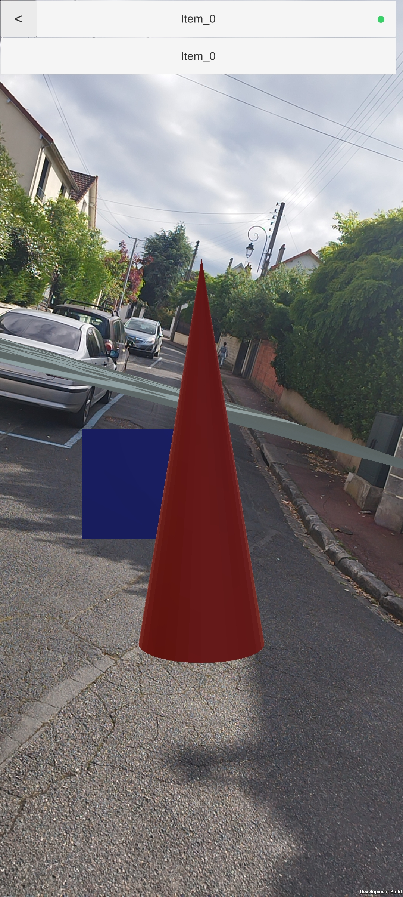

# Test content for the XR Unity Player
This repository provides test content for the XR Player.

Additional information can be found at: https://5g-mag.github.io/Getting-Started/pages/xr-media-integration-in-5g/

# Available content

See individual directories for detailed information.

## Reference assets for testing

### Assets to testing INTERACTIVITY

<table>
<tr>
<th>Asset</th>
<th>Directory</th>
</tr>
<tr>
<td width="300px">

</td>
<td>
Click <a href="geometry"><b>here</a></b> to access the directory which contains <b>solid geometries</b> and variants 
</td>
<tr>
</table>

### Assets to testing ANCHORING

<table>
<tr>
<th>Asset</th>
<th>Directory</th>
</tr>
<tr>
<td width="300px">

</td>
<td>
Click <a href="anchoring"><b>here</a></b> to access the directory which contains <b>solid geometries</b> and variants 
</td>
<tr>
</table>

### Assets to testing MEDIA

<table>
<tr>
<th>Asset</th>
<th>Directory</th>
</tr>
<tr>
<td width="300px">

</td>
<td>
Click <a href="TV"><b>here</a></b> to access the directory which contains <b>a model of a TV set</b> 
</td>
<tr>
<tr>
<td width="300px">

</td>
<td>
Click <a href="video"><b>here</a></b> to access the directory which contains models to <b>integrate audiovisual textures</b> 
</td>
<tr>
</table>

## Media configurations

The scenes that use the MPEG media extensions (`MPEG_media`, `MPEG_buffer_circular`, `MPEG_accessor_timed`, `MPEG_texture_video`, `MPEG_audio_spatial`) cover these media configurations. There is one row per `MPEG_media` entry. The six `ar-video-plane` scenes share the same media configuration and differ only in anchoring.

Last checked: 2026-11-03.

| Scene | Media | Container | Tracks in the media | Buffers fed (track selection) | Timed accessor header | Consumers | Autoplay / loop | Playback started by |
|---|---|---|---|---|---|---|---|---|
| `TV/scene` | 0 `bbb_360p_48k.mp4` | MP4 | video + audio muxed (+ OD/BIFS) | 2 (explicit `#track_ID=201/101`) | audio: yes (32 B), video: no | video texture, Speaker | on / on | autoplay |
| `TV/scene_ycbcr` | 0 `bbb_360p_48k.mp4` | MP4 | video + audio muxed (+ OD/BIFS) | 2 (explicit, YCbCr 4:2:0 texture) | audio: yes, video: no | video texture, Speaker | on / on | autoplay |
| `video/scene-av-combined` | 0 `bbb_360p_48k.mp4` | MP4 | video + audio muxed (+ OD/BIFS) | 2 (explicit `#track_ID=201/101`) | audio: yes, video: no | video texture, Speaker | on / on | autoplay |
| `video/scene-av-independant` | 0 `bbb.aac.mp4` | MP4 | audio | 1 (auto) | yes | Speaker | on / on | autoplay |
| | 1 `bbb.avc.mp4` | MP4 | video | 1 (auto) | no | video texture | on / on | autoplay |
| `video/scene` | 0 `bbb.avc.mp4` | MP4 | video | 1 (auto) | no | video texture | on / on | autoplay |
| `studio_apartment` | 0 `bbb.avc.mp4` | MP4 | video | 1 (auto) | no | video texture | on / on | autoplay |
| | 1 `bbb.aac.mp4` | MP4 | audio | 1 (auto) | yes | Speaker | on / on | autoplay |
| `ar-video-plane/*` (6 scenes) | 0 `ccma_1080p30_avc_2000kbps.mp4` | MP4 | video (1080p30) | 1 (auto) | no | video texture | on / on | autoplay; 5 of the 6 wait for the anchor |
| | 1 `ccma_aac_4800_mono_fltp.mp4` | MP4 | audio | 1 (auto) | yes | Speaker | on / on | autoplay |
| `gravity` | 0, 1, 2 `pong.mp4` (same file 3×) | MP4 | audio | 1 each (auto) | yes | one speaker each | off / off | action: play when that sphere collides with the floor |
| `geometry/UseCase_01-variant3` | 0 `Sound01.mp3` | MP3 | audio | 1 (`count` 3) | yes | Sphere_Gray | off / on | action: collision, play after a 3 s delay, then pause |
| `geometry/UseCase_02-variant3` | 0 `Sound01.mp3` | MP3 | audio | 1 (`count` 5) | yes | Cone | off / off | never (no action) |
| | 1 `Sound02.mp3` (44.1 kHz, resampled to 48 kHz) | MP3 | audio | 1 (`count` 5) | yes | Cone.001 | off / off | never (no action) |
| | 2 `Sound03.mp3` | MP3 | audio | 1 (`count` 5) | yes | Cone.002 | off / off | action: play when the Cylinder becomes visible |
| `geometry/UseCase_03-variant1` | 0, 1, 2 `Sound01/02/03.mp3` | MP3 | audio | 1 each (`count` 5) | yes | Cone, Cone.001, Cone.002 | off / on | action: play and stop on proximity |
| `geometry/UseCase_03-variant3` | 0, 1, 2 `Sound01/02/03.mp3` | MP3 | audio | 1 each (`count` 5) | yes | Cone, Cone.001, Cone.002 | off / off | never (no action) |

Notes:
- "auto" means the buffer has no `tracks`: the media pipeline picks the media's track of the matching kind.
- All timed accessors are immutable. The audio headers are 32 bytes, and the audio data starts right after them.
- Five media never play: media 0 and 1 of `UseCase_02-variant3`, and all three of `UseCase_03-variant3`. They have no autoplay, no `startTime` and no action that plays them.

Not covered by any scene:
- MPEG-DASH or HLS sources, and remote URLs.
- More than one alternative per media.
- One media used by several buffers or consumers. The player's media pipeline does not support it.
- A timed accessor header on a video buffer, and an audio buffer without a header.
- Mutable timed accessors (`immutable: false`). The player does not support them.
- More than one timed accessor in a buffer, such as multichannel audio.
- `autoplayGroup`, `startTime` and a non-zero `startTimeOffset`.
- `MEDIA_RESUME`, and pausing a video.

# Questions or Comments

If you have any questions, please submit an issue.
